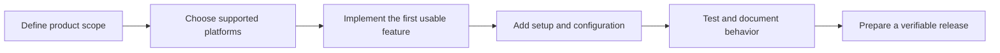

# G-MUSIC

**A workspace for future music-related software experiments.**

---

## Repository status

The current main branch contains this initial documentation only. No application source code, entry point, dependency manifest, build configuration, or runnable release has been added yet.

This README establishes the repository's intended direction without claiming features or a technology stack that has not been implemented.

## Repository development flow

There is no application workflow to diagram yet because the repository does not contain an implementation. The following is a documentation roadmap, not a description of existing functionality.

## Planned documentation

When an initial implementation is committed, expand this document with:

- Product purpose and target audience.
- Implemented features and supported platforms.
- Confirmed technology stack and dependency versions.
- Setup instructions and required configuration.
- Screenshots or a demonstration link.
- Testing, accessibility, and release status.
- Licensing and media-attribution requirements.

## Contribution and media guidance

Use appropriately licensed music, artwork, and other media assets. Document attribution and usage rights where required. Do not commit credentials, private API keys, or copyrighted content without permission.

## Author

**Gusty Faqikh** · [GitHub](https://github.com/gusti111)